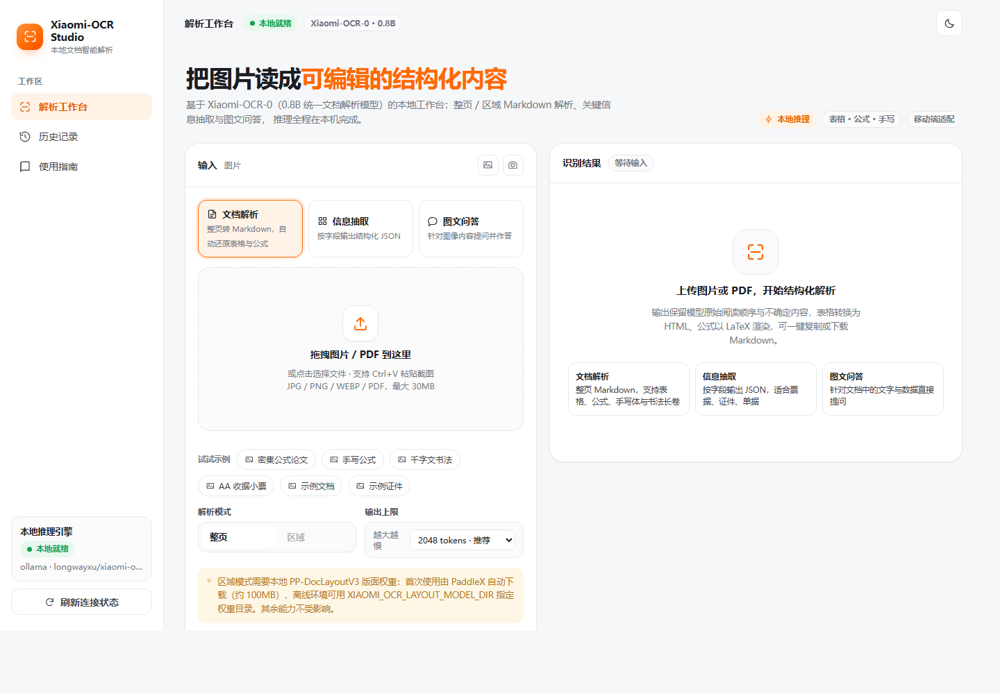
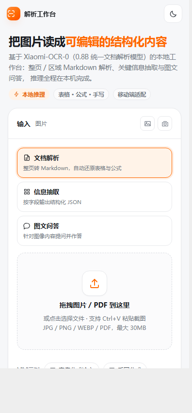
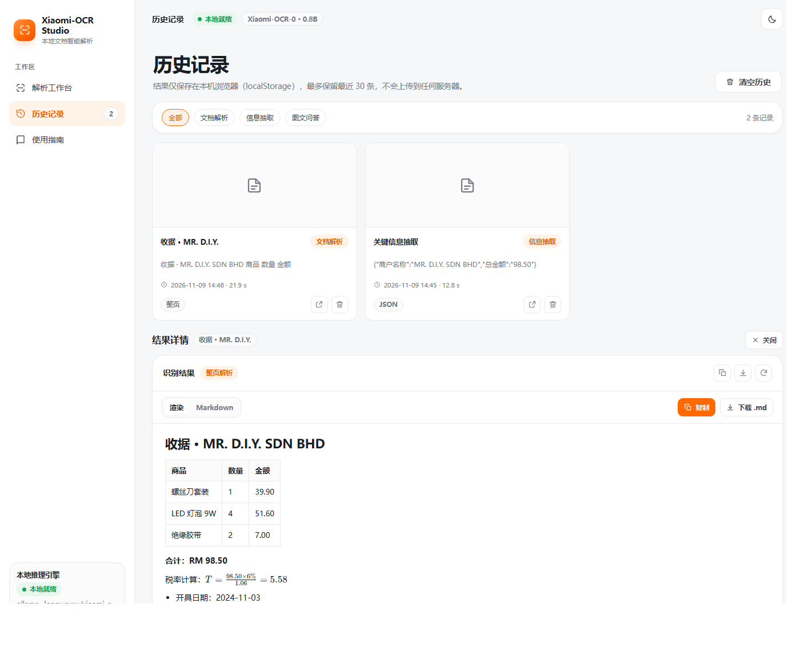
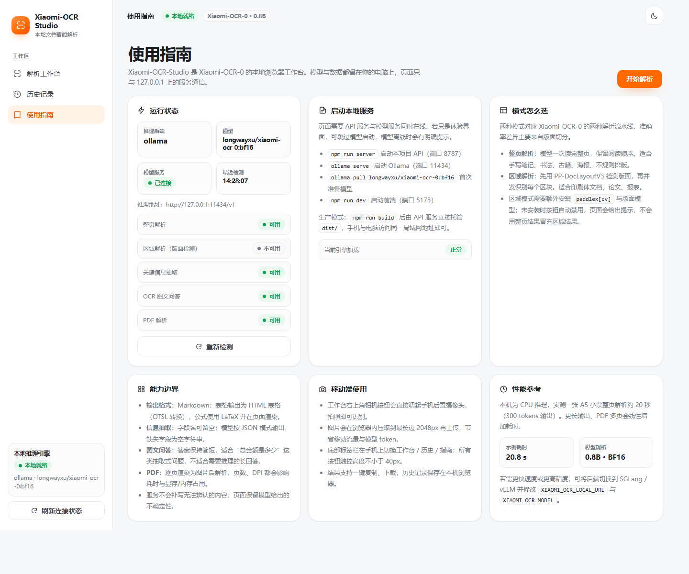

# Xiaomi-OCR Studio

基于 **Xiaomi-OCR-0** 的本地 OCR 工作台。前端使用 **Vue 3 + TypeScript + Vite**，后端是一个零第三方依赖的 Python 网关，负责调用本机推理服务（Ollama / SGLang / vLLM），并把官方 MCP 引擎的提示词、版面检测与后处理逻辑原样复用。

- 桌面端是双栏工作台：左侧选任务与上传，右侧实时看到 Markdown / JSON / 答案。
- 手机端自动切换为单列 + 底部导航，支持相册、拍照、粘贴与示例图。
- 所有推理都留在本机，图片不会离开这台电脑。

## 功能

| 能力 | 说明 | 输出 |
| --- | --- | --- |
| 文档解析（整页） | 整张图转 Markdown，按阅读顺序组织，表格转 OTSL/HTML，公式转 LaTeX | Markdown |
| 文档解析（区域） | 先用 PP-DocLayoutV3 做版面检测，逐区域识别后按版面顺序拼装；适合印刷体长文档 | Markdown |
| 信息抽取（KIE） | 按指定字段输出 JSON；字段留空时由模型自行归纳 | JSON |
| 图文问答（VQA） | 针对票据、证件、截图提问，答案保持简短 | 文本 |
| PDF 解析 | 按页渲染（pypdfium2）后并发识别，页与页之间用 `<!-- page n -->` 分隔 | Markdown |
| 历史记录 | 最近 30 条结果存在 localStorage，可回看、复制、导出 | — |
| 导出 / 复制 | Markdown、JSON 一键复制或下载 | — |

模型行为遵循 Xiaomi-OCR-0 的约定：不补写不可辨认的内容，表格用 OTSL、公式用 LaTeX，保留阅读顺序。

## 界面预览

| 桌面工作台 | 手机端 |
| --- | --- |
|  |  |

| 识别结果（表格 + 公式） | 使用指南 |
| --- | --- |
|  |  |

## 架构

```
浏览器 (Vue 3 / TS)
  ├─ 开发: Vite dev server :5173  ──/api 代理──┐
  └─ 生产: 由网关直接托管 dist/                │
                                              ▼
                          Python 标准库网关 :8787  (server/app.py)
                                              │  复用官方引擎
                                              ▼
              Xiaomi-OCR-0/skills/xiaomi-ocr/mcp_ocr_server.py
              （图片归一化、提示词、版面检测、裁剪、后处理）
                                              │  仅 loopback
                                              ▼
                    Ollama / SGLang / vLLM  http://127.0.0.1:11434/v1
```

网关只做四件事：读取请求、校验参数、串行调度推理、把引擎返回的字段转成前端契约。提示词与后处理不在网关里重写，因此网页结果和命令行结果一致。

## 环境要求

- Node.js ≥ 18（实测 v22）
- Python ≥ 3.10（实测 3.12），需要 `pypdfium2` 才有 PDF 解析；`paddlex` + `paddlepaddle` 才有区域模式
- 本机已有 **Xiaomi-OCR-0** 仓库（默认放在本项目的上一级目录）
- 一个 OpenAI 兼容的本地推理服务，默认 Ollama `127.0.0.1:11434`

检查模型是否就绪：

```bash
ollama list                 # 应能看到 longwayxu/xiaomi-ocr-0:bf16
curl http://127.0.0.1:11434/v1/models
```

## 快速开始

### 1. 启动网关（生产模式，网关同时托管前端）

```bash
npm install            # 首次
npm run build          # 类型检查 + 打包到 dist/
npm run server         # http://127.0.0.1:8787
```

Windows 也可以直接双击 `start.cmd`：它会挑一个可用的 Python、在 `dist/` 缺失时自动构建、打开浏览器并启动网关。

`npm run server` 用的是 PATH 里的 `python`。如果 Python 装在虚拟环境里（推荐），先激活虚拟环境，或直接指定解释器：

```bash
..\Xiaomi-OCR-0\skills\xiaomi-ocr\.venv\Scripts\python.exe server\app.py
```

### 2. 开发模式（热更新）

```bash
npm run server     # 终端 A：网关 :8787
npm run dev        # 终端 B：前端 :5173（/api 已代理到 8787）
```

浏览器打开 http://127.0.0.1:5173，手机连同一局域网后访问 `http://<电脑 IP>:5173`。

### 3. 自检

```bash
python scripts\smoke_test.py --sample receipt.jpg
python scripts\smoke_test.py --task kie --sample receipt.jpg --fields 商户名称 总金额
python scripts\smoke_test.py --task vqa --sample receipt.jpg --question "总金额是多少？"
```

脚本会打印健康状态、耗时和结果片段；`--save out.json` 可保存完整响应。

## API

网关地址默认 `http://127.0.0.1:8787`，所有接口使用 JSON，图片/PDF 以 base64 传输（单文件上限 30MB）。

| 方法 | 路径 | 请求体 | 响应要点 |
| --- | --- | --- | --- |
| GET | `/api/health` | — | `modelOnline`、`engineReady`、`capabilities{page,region,kie,vqa,pdf}`、`regionHint` |
| GET | `/api/samples` | — | `items[{name,label,url}]` |
| GET | `/api/samples/{name}` | — | 示例图片二进制 |
| POST | `/api/ocr` | `{image, mode:"page"\|"region", max_tokens}` | `kind:"document"`、`markdown`、`mode`、`regions?`、`elapsedMs` |
| POST | `/api/kie` | `{image, fields:[...], max_tokens}` | `kind:"kie"`、`json`、`raw?`、`warning?`、`elapsedMs` |
| POST | `/api/vqa` | `{image, question}` | `kind:"vqa"`、`answer`、`elapsedMs` |
| POST | `/api/pdf` | `{pdf, mode, max_pages, dpi, max_tokens}` | `kind:"document"`、`markdown`、`pages`、`elapsedMs` |

出错时返回 `{"detail": "人话错误信息"}` 与非 200 状态码，前端会把 `detail` 显示成错误条。

## 环境变量

| 变量 | 默认值 | 作用 |
| --- | --- | --- |
| `XIAOMI_OCR_REPO` | `../Xiaomi-OCR-0` | Xiaomi-OCR-0 仓库位置 |
| `XIAOMI_OCR_LOCAL_URL` | `http://127.0.0.1:11434/v1` | 推理服务地址，必须是 loopback |
| `XIAOMI_OCR_MODEL` | `longwayxu/xiaomi-ocr-0:bf16` | 模型名 |
| `XIAOMI_OCR_BACKEND` | `ollama` | 仅用于界面展示 |
| `XIAOMI_OCR_HOST` / `XIAOMI_OCR_PORT` | `0.0.0.0` / `8787` | 网关监听地址 |
| `XIAOMI_OCR_MAX_UPLOAD_MB` | `30` | 单个文件上限 |
| `XIAOMI_OCR_LAYOUT_MODEL_DIR` | 空 | 已有 PP-DocLayoutV3 权重目录，指定后区域模式免下载 |
| `XIAOMI_OCR_MAX_TOKENS` / `XIAOMI_OCR_CONCURRENCY` | 引擎默认 | 官方引擎的生成上限与并发度 |

## 目录结构

```
xiaomi-ocr-studio/
├─ src/
│  ├─ views/ConsoleView.vue      # 主工作台：任务、上传、参数、结果
│  ├─ views/HistoryView.vue      # 历史记录
│  ├─ views/GuideView.vue        # 使用指南与运行状态
│  ├─ components/ResultPanel.vue # Markdown / JSON / 答案渲染（KaTeX + DOMPurify）
│  ├─ components/AppIcon.vue     # 内联 SVG 图标
│  ├─ lib/                       # api / files / markdown / health / toast / format / types
│  ├─ stores/history.ts          # localStorage 历史
│  ├─ App.vue                    # 外壳：侧栏、顶栏、移动端底栏、主题
│  └─ assets/main.css            # 设计系统与响应式样式
├─ server/app.py                 # 标准库网关（无第三方依赖）
├─ scripts/smoke_test.py         # 端到端自检
├─ docs/screenshots/             # 界面截图
├─ start.cmd                     # Windows 一键启动
└─ vite.config.ts
```

## 移动端

- 断点：`1080px` 收起右侧详情、`860px` 切换为单列并显示底部导航、`480px` 压缩字号与间距。
- 上传区同时提供「相册」与「拍照」（`capture="environment"`），也支持直接粘贴截图。
- 推理前会在浏览器里把长边压到 2048px 再上传，省流量、省 token；原图不会上传。
- 表单输入使用 16px 字号并带 `safe-area` 内边距，避免 iOS 聚焦缩放与底部手势条遮挡。
- 单次请求耗时较长（CPU 推理约 20 秒/页），界面有运行计时与中断提示，不会误以为卡死。

## 实测与限制

- 本机（无 GPU，Ollama CPU）实测：`receipt.jpg` 整页解析 21.9 秒，输出 529 字符完整小票文本；字段抽取 1.7 秒得到 `{"商户名称":"MR.D.I.Y.SDNBHD","总金额":"RM5.90","日期":"2017-10-18"}`；图文问答 2.2 秒回答「RM 5.90」；单页 PDF 按页渲染后解析 16.5 秒，标题与两行金额均正确。`/api/health` 中 `modelOnline`、`page`、`kie`、`vqa`、`pdf` 均可用。
- 区域模式依赖 PaddleX 的 PP-DocLayoutV3 权重。权重未缓存时健康检查会如实标记 `region=false` 并在界面提示；首次使用会触发下载（约 100MB），离线环境请用 `XIAOMI_OCR_LAYOUT_MODEL_DIR` 指定本地权重。
- 网关对推理加锁，一次只处理一个请求：CPU 环境下并发只会拖慢整体速度。
- 输出上限受模型上下文约束；页面参数 `max_tokens` 默认 2048，遇到超长文档可调高，但会变慢。
- 模型不补写模糊内容，识别不到的字段会留空，这是设计行为而非 bug。

## 常见问题

**页面提示“无法连接本地服务”** —— 网关没起或端口被占用。先访问 `http://127.0.0.1:8787/api/health`，若端口冲突：`set XIAOMI_OCR_PORT=8790` 后重启网关。

**`modelOnline: false`** —— 推理服务未启动或模型名不匹配。确认 `ollama list` 里有对应模型，必要时改 `XIAOMI_OCR_MODEL`。

**`npm run build` 报 `spawn EPERM`** —— 某些受限沙箱禁止 esbuild 创建子进程。把构建放到普通终端执行即可；本项目的构建产物已在 `dist/`。

**PyPI 不可用** —— 不需要。网关只用 Python 标准库，`server/` 下没有 `requirements.txt`。

**手机打不开** —— 手机与电脑需在同一局域网，且防火墙放行 8787（生产）或 5173（开发）。网关默认监听 `0.0.0.0`。
